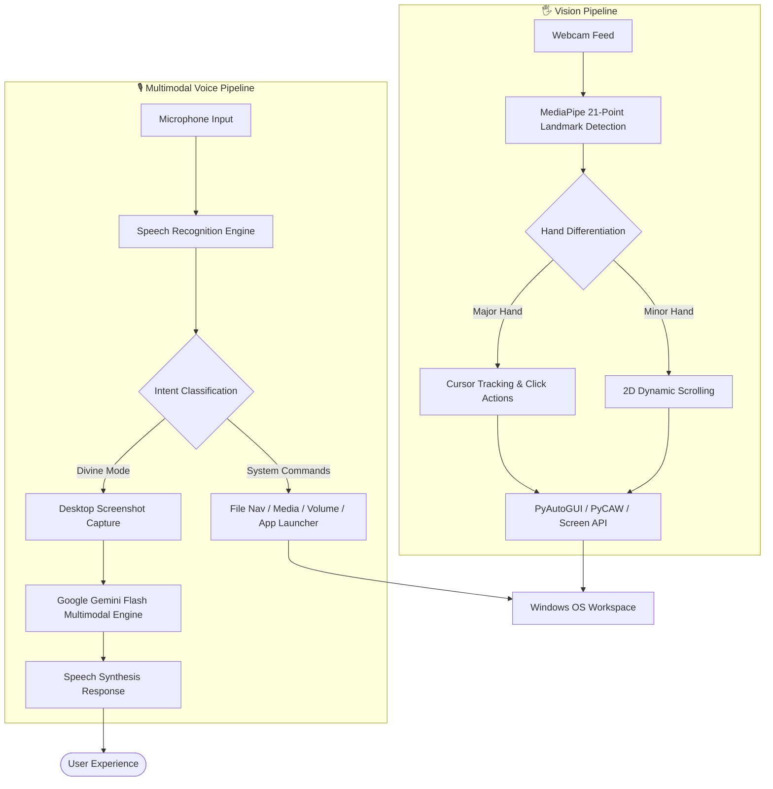

# KrishnaVision (Glide-Connect)

<div align="center">

### A Multimodal Virtual Interface Combining MediaPipe-Hands Optimization and Gemini AI for Context-Aware Human-Computer Interaction

[](https://www.python.org/downloads/)
[](https://www.microsoft.com/windows)
[](https://ijirt.org/article?manuscript=180711)
[](https://opensource.org/licenses/MIT)

</div>

---

## 📌 Overview

**KrishnaVision** is a touchless Human-Computer Interaction (HCI) framework designed to control desktop interfaces through real-time computer vision and multimodal intelligence. By coupling optimized **MediaPipe** 21-point hand landmark tracking with a custom conversational agent powered by **Google Gemini AI**, KrishnaVision provides a dual-modality interaction layer for full mouse operations, desktop automation, system telemetry adjustments, and on-screen visual reasoning.

---

## 📄 Research Paper & Citation

Published in the *International Journal of Innovative Research in Technology (IJIRT)*, Vol. 12, Issue 1 (2025).

> **KrishnaVision: A Multimodal Virtual Interface Combining MediaPipe-Hands Optimization and Gemini AI for Context-Aware HCI**  
> *R. De and A. Saha*  
> [Read the full paper on IJIRT](https://ijirt.org/article?manuscript=180711)

### BibTeX Citation
```bibtex
@article{de2025krishnavision,
  title={KrishnaVision: A Multimodal Virtual Interface Combining MediaPipe-Hands Optimization and Gemini AI for Context-Aware HCI},
  author={De, Rupkatha and Saha, Aritro},
  journal={International Journal of Innovative Research in Technology (IJIRT)},
  volume={12},
  number={1},
  pages={2909--2917},
  year={2025},
  url={https://ijirt.org/article?manuscript=180711}
}
```

---

## 📐 System Architecture



---

## 🚀 Key Features

### 1. Vision-Based Gesture Controller
- **Dual-Hand Disambiguation:** Distinguishes between the Major hand (dominant) and Minor hand (auxiliary) for contextual multi-action execution.
- **Sub-Pixel Cursor Tracking:** Normalized coordinates scaled to display boundaries with smoothing buffers to eliminate jitter.
- **Full Click Matrix:** Dedicated stable gestures for single-click, double-click, and right-click without false positives.
- **Fist Drag & Drop:** Intuitive fist clench to lock mouse-down, drag across virtual workspaces, and release.
- **Continuous 2D Scrolling:** Minor hand pinch-and-glide enables vertical and horizontal viewport navigation.
- **Hardware Telemetry Control:** Pinch distance scaling for direct real-time master volume and display brightness modulation.

### 2. Conversational Voice Agent ("Krishna")
- **Hands-Free Module Control:** Voice commands to launch, calibrate, and terminate the vision tracking worker.
- **Intelligent File System Navigation:** Directory traversal, file indexing, and file opening using simple spoken indices.
- **Divine Mode (Multimodal Contextual Reasoning):** One-shot screen analysis powered by Google Gemini — capture desktop states, error dialogs, or documents and ask conversational questions about what is on screen.
- **Desktop Automation:** Voice-triggered copy/paste, quick Google and Maps queries, system sleep/wake states, and time utilities.

---

## 🖐️ Gesture Control Reference

| Gesture | Hand | Action | Description |
| :--- | :--- | :--- | :--- |
| **Open Palm / Neutral** | Either | **Idle / Reset** | Default neutral state; resets click readiness flags. |
| **'V' Sign (Index + Middle Up)** | Major | **Move Cursor** | Smooth cursor navigation across the active monitor. |
| **Middle Finger Lowered (Index Up)** | Major | **Left Click** | Triggers standard primary mouse click. |
| **Index Finger Lowered (Middle Up)** | Major | **Right Click** | Triggers secondary context menu click. |
| **Tips Pinched Together ('V' Sign)** | Major | **Double Click** | Triggers instantaneous double click. |
| **Closed Fist** | Major | **Drag & Drop** | Holds left mouse button down; release palm to drop. |
| **Pinch Glide (Vertical / Horizontal)** | Minor | **Scroll Viewport** | Up/down vertical scroll; left/right horizontal scroll. |
| **Pinch Glide (Vertical / Horizontal)** | Major | **Volume & Brightness** | Vertical movement modulates volume; horizontal modulates brightness. |

> *Note: A 4-frame temporal pose stability buffer is applied to avoid accidental gesture triggers during fast movements.*

---

## 🎙️ Spoken Voice Commands

| Category | Spoken Prompt | System Action |
| :--- | :--- | :--- |
| **Module Control** | `"launch gesture recognition"` | Boots the OpenCV & MediaPipe tracking thread. |
| | `"stop gesture recognition"` | Gracefully shuts down computer vision tracking. |
| **Divine Mode (GenAI)** | `"enter divine mode"` | Activates Google Gemini contextual agent. |
| | `"look at my screen"` | Captures screen buffer and answers queries via Gemini Vision. |
| | `"exit divine mode"` | Returns to standard assistant mode. |
| **File Navigation** | `"list"` | Lists directories in current working path. |
| | `"open [number]"` | Opens corresponding file or enters subdirectory. |
| | `"back"` | Traverses to parent directory. |
| **Productivity** | `"search [query]"` | Spawns browser with Google Search query. |
| | `"location"` | Prompts for target destination and opens Google Maps. |
| | `"copy"` / `"paste"` | Injects `Ctrl+C` or `Ctrl+V` system keystrokes. |
| **Lifecycle** | `"bye"` / `"wake up"` | Puts assistant to standby / resumes listening. |
| | `"exit"` | Shuts down Krishna voice runtime. |

---

## 🛠️ Project Structure

```text
├── README.md
├── requirements.txt
├── LICENSE
├── .env.example
└── src/
    ├── Voice_Assistant.py      # Core voice engine, intent parser & speech loop
    ├── Gesture_Controller.py    # MediaPipe hand pipeline & virtual mouse driver
    ├── GenAI.py                 # Gemini Flash integration (multimodal & text)
    ├── app.py                   # Eel web-based interface bridge
    ├── web/                     # Frontend UI assets for conversational GUI
    └── logs/                    # Runtime telemetry & conversational history
```

---

## ⚡ Quickstart & Installation

### Prerequisites
- **Python:** 3.9.21 (Recommended: Anaconda / Miniconda)
- **OS:** Windows 10 / 11 (requires `pywin32`, `pycaw`, `screen_brightness_control`)
- **Peripherals:** Standard webcam & microphone

### 1. Clone & Set Up Virtual Environment

```bash
git clone https://github.com/halcyon-past/Glide-Connect.git
cd Glide-Connect

# Create conda environment
conda create -n krishnavision python=3.9.21 -y
conda activate krishnavision

# Install dependencies
pip install -r requirements.txt
conda install pywin32 -y
```

### 2. Configure Environment Variables

Create a `.env` file in the `src/` directory:

```bash
cd src
cat <<EOF > .env
GEMINI_API_KEY=your_google_gemini_api_key_here
GEMINI_MODEL_NAME=gemini-2.0-flash-lite
EOF
```
*(Get your free API key at [Google AI Studio](https://aistudio.google.com/apikey))*

### 3. Launch the Application

* **Full Multimodal Assistant (Voice + Gesture on demand):**
  ```bash
  python Voice_Assistant.py
  ```

* **Standalone Gesture Recognition:**
  ```bash
  python Gesture_Controller.py
  ```
  *(Press `Enter` inside the camera preview window to terminate).*

---

## 👥 Authors & Research Team

| Name | Role & Links |
| :--- | :--- |
| **Aritro Saha** | [](https://github.com/halcyon-past) [](https://www.linkedin.com/in/aritro-saha/) [](https://www.youtube.com/@veripyed) |
| **Rupkatha De** | [](https://github.com/rupkatha-de) [](https://www.linkedin.com/in/rupkatha-de-80a422231/) |
| **Anusmita Panji** | [](https://www.linkedin.com/in/anusmita-panji-a509551b5) |

---

## 📜 License

This project is licensed under the [MIT License](LICENSE).
